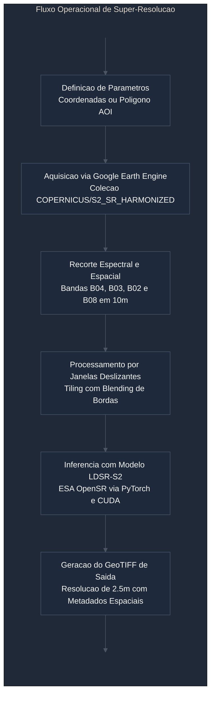

# opensr-sentinel-pipeline

Ambiente de processamento e super-resolucao espacial para imagens multiespectrais do satelite Sentinel-2 utilizando o modelo Latent Diffusion Super-Resolution (LDSR-S2) da iniciativa ESA OpenSR, integrado ao Google Earth Engine e Google Colab.

## 1. Visao Geral

O projeto disponibiliza fluxos reprodutiveis para elevar a resolucao espacial das bandas do espectro visivel e infravermelho proximo (B02, B03, B04 e B08) do sensor Sentinel-2 MSI de 10 metros para 2.5 metros por pixel, representando um fator de ampliacao de quatro vezes (4x).

Diferente de abordagens proprietarias baseadas em servicos fechados, a solucao emprega pesos abertos e arquiteturas publicas auditaveis desenvolvidas sob coordenacao da Agencia Espacial Europeia (ESA) e disponibilizadas publicamente sob a licenca Apache 2.0.



## 2. Estrutura dos Cadernos de Operacao

O repositorio esta estruturado em dois cadernos executaveis independentes no Google Colab:

### Modulo 1: Inspecao e Exploracao Pontual
* Arquivo: `OpenSR_Exploracao_Inferencia_Colab.ipynb`
* Finalidade: Inspecao rapida e validacao visual pontual.
* Metodo de entrada: Par de coordenadas geograficas (longitude e latitude) e definicao do raio de abrangencia.
* Saida: Comparativo visual em matriz 2x2 com composicoes coloridas RGB e falsa-cor NIR, alem do GeoTIFF georreferenciado local.

### Modulo 2: Producao por Poligono de Area de Interesse
* Arquivo: `OpenSR_Producao_Poligono_Colab.ipynb`
* Finalidade: Processamento operacional de grandes extensoes territoriais delimitadas por vetores.
* Metodo de entrada: Arquivo compactado Shapefile (.zip) ou poligono em coordenadas geograficas.
* Mecanismo de processamento: Janelas deslizantes (tiling) de 128x128 pixels com sobreposicao de bordas e ponderacao por funcao Hanning, prevenindo esgotamento de memoria VRAM e suprimindo descontinuidades na montagem do mosaico.
* Saida: Exportacao automatizada do GeoTIFF final super-resolvido em 2.5 metros por pixel com projecao espacial mantida diretamente no Google Drive do usuario.

## 3. Especificacoes Tecnicas do Modelo

| Parametro | Especificacao |
| :--- | :--- |
| Arquitetura | Latent Diffusion Super-Resolution (LDSR-S2) |
| Origem dos Pesos | ESAOpenSR (European Space Agency) via Hugging Face |
| Resolucao de Entrada | 10 metros por pixel |
| Resolucao de Saida | 2.5 metros por pixel |
| Bandas Processadas | B02 (Azul), B03 (Verde), B04 (Vermelho), B08 (NIR) |
| Fator de Escala | 4x |
| Requisito de Hardware | Placa grafica com suporte a CUDA (GPU T4 recomendada) |
| Licenca de Codigo | Apache 2.0 |

## 4. Requisitos e Instalacao

Para execucao remota no Google Colab, recomenda-se selecionar o ambiente de execucao com acelerador por hardware configurado para GPU (T4).

As dependencias essenciais do projeto sao:

```bash
pip install opensr-model "opensr-utils[model]" omegaconf rasterio geopandas geemap earthengine-api
```

A autenticacao no Google Earth Engine requer um projeto habilitado na Google Cloud Platform previamente associado a conta do operador. O projeto padrao configurado nos cadernos e `sentinel-landsat-download`.

## 5. Procedimento de Utilizacao

1. Selecionar o caderno correspondente a necessidade da analise (exploracao pontual ou producao por poligono).
2. Abrir o arquivo no Google Colab por meio do botao de execucao remota no cabecalho.
3. Confirmar a inicializacao da sessao com acelerador GPU ativado.
4. Executar as celulas sequenciais de autenticacao do Earth Engine e montagem do Google Drive.
5. Indicar os parametros da area (coordenadas ou upload do arquivo vetorial) e a janela temporal.
6. Acompanhar o processamento por janelas deslizantes e a gravacao do produto GeoTIFF final no diretorio designado.

## 6. Referencias e Creditos

* Repositorio oficial ESAOpenSR: https://github.com/ESAOpenSR/opensr-model
* Catalogo Copernicus Sentinel-2: Agencia Espacial Europeia (ESA)
* Google Earth Engine API: Google LLC
