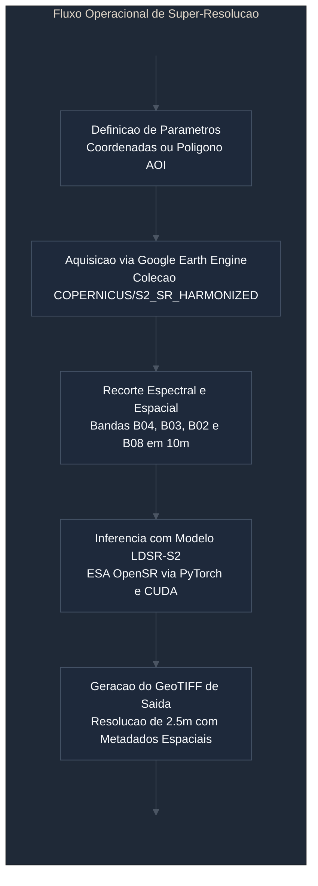

# opensr-sentinel-pipeline

Ambiente de processamento e super-resolucao espacial para imagens multiespectrais do satelite Sentinel-2 utilizando o modelo Latent Diffusion Super-Resolution (LDSR-S2) da iniciativa ESA OpenSR, integrado ao Google Earth Engine e Google Colab.

## 1. Visao Geral

O projeto disponibiliza fluxos reprodutiveis para elevar a resolucao espacial das bandas do espectro visivel e infravermelho proximo (B02, B03, B04 e B08) do sensor Sentinel-2 MSI de 10 metros para 2.5 metros por pixel, representando um fator de ampliacao de quatro vezes (4x).

Diferente de abordagens proprietarias baseadas em servicos fechados, a solucao emprega pesos abertos e arquiteturas publicas auditaveis hospedadas no Hugging Face, sob a licenca Apache 2.0.



## 2. Estrutura dos Modulos

O repositorio esta estruturado em dois fluxos complementares de trabalho:

1. **Modulo de Exploracao Pontual (`OpenSR_Exploracao_Inferencia_Colab.ipynb`)**
   Voltado para inspecao rapida de alvos e comparacao qualitativa direta. O usuario informa um par de coordenadas geograficas, a janela temporal e o limite maximo de cobertura de nuvens. O sistema localiza a cena otimizada no acervo do Earth Engine, recorta um recorte de teste e processa a inferencia exibindo composicoes em cor verdadeira e falsa-cor.

2. **Modulo de Producao por Area de Interesse**
   Voltado para execucao sobre poligonos delimitados por arquivos vetoriais. O processamento segmenta a extensao em janelas regulares com sobreposicao para controle de memoria de video na placa aceleradora, recompondo o mosaico final georreferenciado sem descontinuidades nas bordas dos blocos.

## 3. Caracteristicas Tecnicas do Modelo

| Parametro | Especificacao |
| :--- | :--- |
| Arquitetura | Latent Diffusion Super-Resolution (LDSR-S2) |
| Origem dos Pesos | ESAOpenSR (European Space Agency) via Hugging Face |
| Resolucao de Entrada | 10 metros por pixel |
| Resolucao de Saida | 2.5 metros por pixel |
| Bandas Processadas | B02 (Azul), B03 (Verde), B04 (Vermelho), B08 (NIR) |
| Fator de Escala | 4x |
| Requisito de Hardware | Placa grafica com suporte a CUDA (GPU T4 recomendada) |
| Licenca de Codigo | Apache 2.0 |

## 4. Requisitos e Configuracao de Ambiente

Para execucao remota no Google Colab, recomenda-se selecionar um ambiente com acelerador por hardware configurado para GPU.

As bibliotecas fundamentais utilizadas no fluxo sao:

```bash
pip install opensr-model omegaconf rasterio geemap earthengine-api
```

A autenticacao no Google Earth Engine requer a configuracao previa de um projeto habilitado na Google Cloud Platform associado a conta do operador.

## 5. Procedimento de Execucao

1. Abrir o notebook desejado no ambiente Google Colab.
2. Validar a inicializacao do projeto Google Earth Engine.
3. Informar as coordenadas do ponto central ou fornecer o arquivo vetorial da area de estudo.
4. Definir o periodo temporal para selecao automatica da menor cobertura de nuvens.
5. Executar as etapas sequenciais de inferencia do modelo.
6. Coletar o arquivo GeoTIFF gerado no diretorio de saida ou transferi-lo para o armazenamento em nuvem.

## 6. Referencias e Creditos

* Repositorio oficial ESAOpenSR: https://github.com/ESAOpenSR/opensr-model
* Catalogo Copernicus Sentinel-2: Agencia Espacial Europeia (ESA)
* Google Earth Engine API: Google LLC
